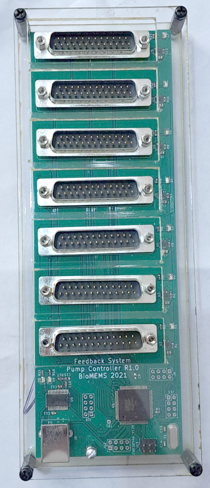

# bioreactor-feedback-system
Bioreactor Feedback System Software and Hardware

## Pump Control Hardware

## Pump Control Connection

The pump controller accepts human-readable commands that are sent over a serial connection. To connect to the pump controller manually, use a program like [PuTTY](https://www.putty.org/) on Windows:

1. Open Device Manager, and take note of the COM ports that are listed.
2. Plug in the pump controller with a USB cable, and look to see which COM port was added (it will be something like "COM9").
3. Open PuTTY, and change "Connection Type" to "Serial".
4. Type in the COM port that you identified earlier under "Serial Line". Change the speed to "115200".
5. Click "Open". You can now type commands and hit enter to send them to the pump controller.

## Command Reference

### `setspeed [PUMP] [SPEED]`
Sets the speed of the pump specified by PUMP to the percentage specified by SPEED. Example: `setspeed 7 50` sets pump 7 to 50% speed.

### `setdir [PUMP] [DIR]`
Sets the direction of the pump specified by PUMP to counterclockwise if DIR is 0 and clockwise if DIR is 1. Example: `setdir 2 0` sets pump 7 to counterclockwise.

### `start [PUMP]`
Starts the pump specified by PUMP. Example: `start 2` starts pump 2.

### `stop [PUMP]`
Stops the pump specified by PUMP. Example: `stop 4` stops pump 4.

### `getspeed [PUMP]`
Prints the speed of the pump specified by PUMP. Example: if pump 6 is running at 35% speed, `getspeed 6` will print `35`.

### `getalarm [PUMP]`
Prints the alarm state of the pump specified by PUMP. Example: if pump 6 is under alarm, `getalarm 6` will print `Alarm!`. If it is not, it will print `Safe`.
